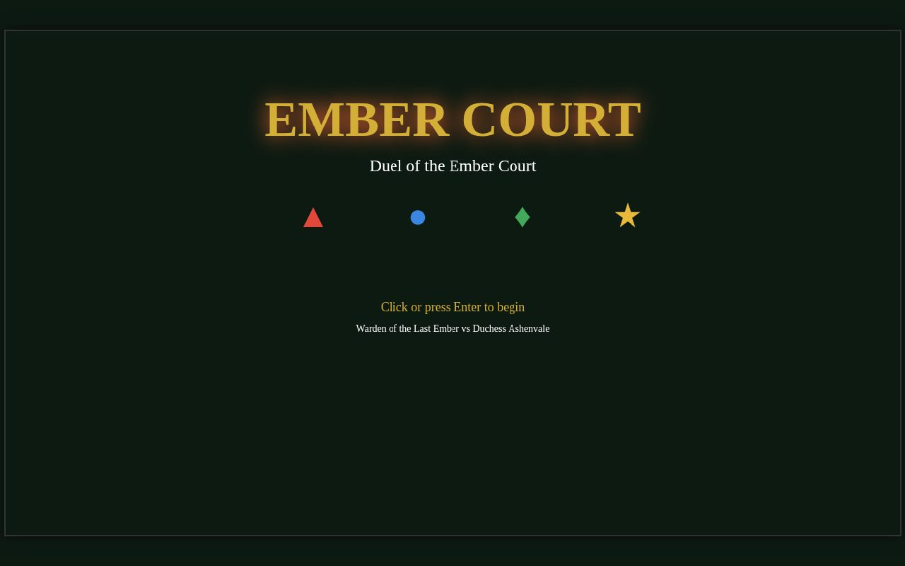
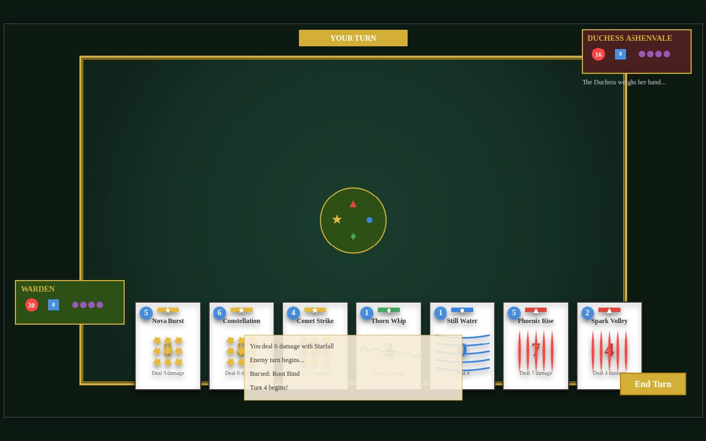
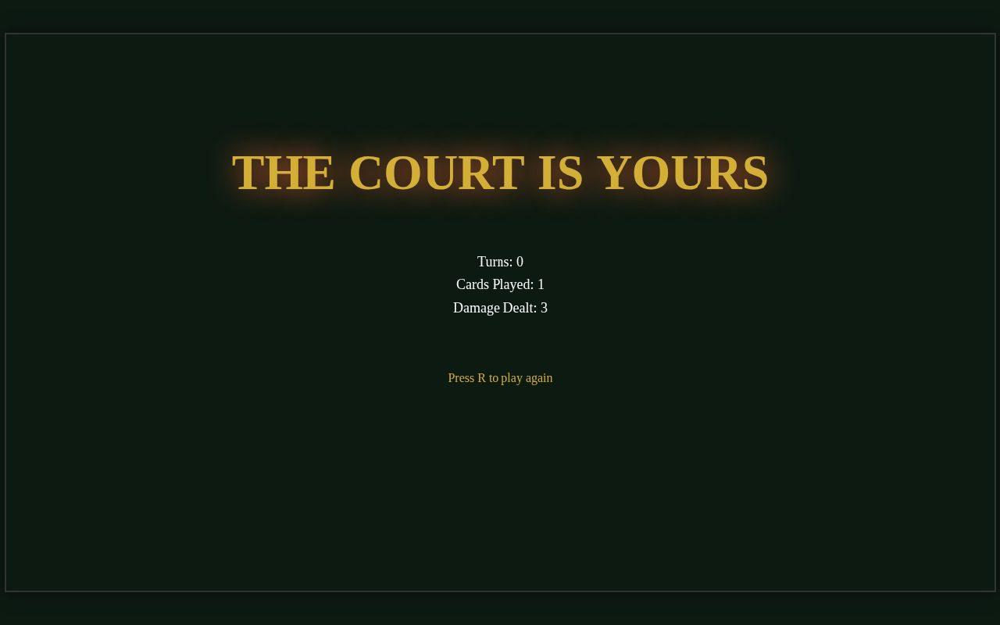
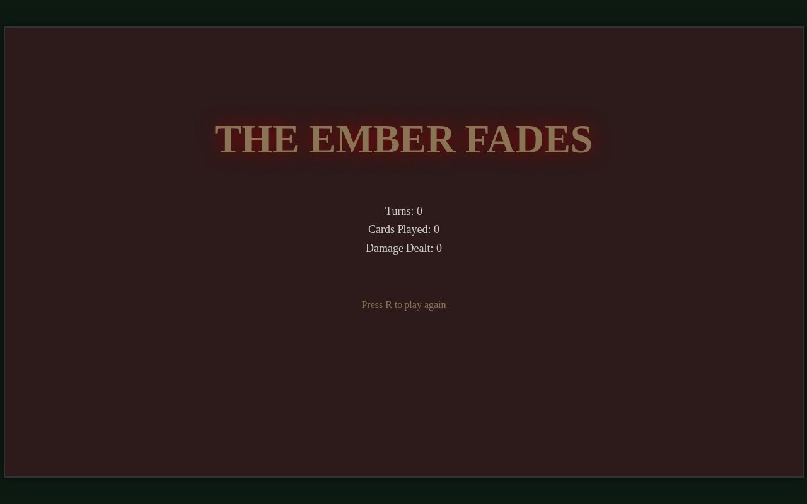

# Ember Court — Duel of the Ember Court (Warden of the Last Ember vs Duchess Ashenvale, 30 Ember life, resonance +2)

Ember Court is a strategic card game where players engage in tactical battles using a deck of enchanted cards. Each card belongs to one of four elemental suits: Flame, Tide, Thorn, and Star. The game combines strategy, luck, and tactical decision-making in a turn-based format.

## How to Play

**Controls:**
- **Mouse**: Click to select cards and interact with the game interface
- **Number Keys 1-7**: Quick card selection and actions
- **Enter**: Confirm card play or action
- **E**: End turn
- **R**: Restart game
- **Esc**: Return to main menu

**Gameplay:**
1. Start with a hand of 7 cards
2. Each turn, play cards to attack your opponent or defend yourself
3. Cards have different values and special abilities based on their suit
4. **Resonance Rule**: Playing cards of the same suit consecutively creates powerful combo effects
5. Reduce your opponent's health to zero to win, or avoid having your health reach zero

## Card Suits

- **Fire (🔥)**: High damage, aggressive attacks
- **Water (💧)**: Healing and defensive abilities
- **Earth (🌍)**: Balanced stats, reliable effects
- **Air (🌪️)**: Speed and evasion-focused cards

## Screenshots

| Start | Play | Win | Loss |
|-------|------|-----|------|
|  |  |  |  |

## Technology

- **Vanilla JavaScript Canvas**: No external dependencies, pure ES6 modules
- **No Network Required**: Fully playable offline
- **Responsive Design**: Adapts to different screen sizes
- **Modular Architecture**: Clean separation of game logic, rendering, and input handling

## Bounty

This entry is part of the make.fun best card game bounty:
[https://make.fun/bounty/best-card-game-20261122-1826](https://make.fun/bounty/best-card-game-20261122-1826)
